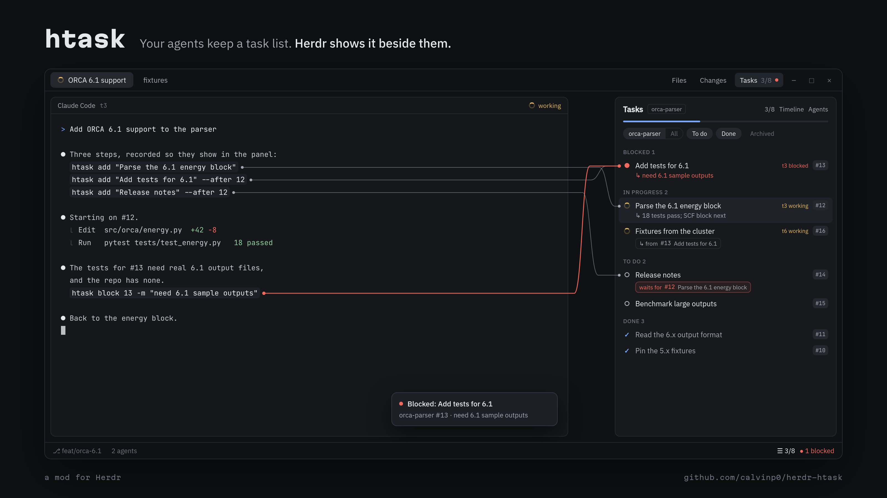
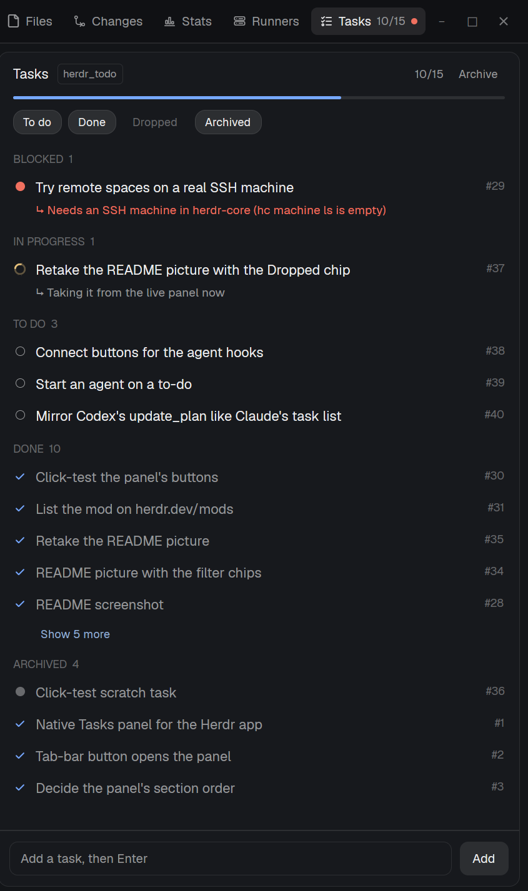
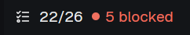

# htask: a task panel for coding agents in Herdr

[](https://github.com/calvinp0/herdr-htask/actions/workflows/tests.yml)



A side panel for [Herdr](https://herdr.dev) that shows what your coding agents have done, what
they're doing, what's blocked and what's left. It follows the terminal you focus and updates live.

It tracks the agents' own plans as they work, rather than a to-do list of what you ask for (for
that, see mods like Over9k To-do).

The picture above is an illustration. Here is the real panel, showing this repo's own tasks:

<p align="center">
  
</p>

The status bar gets a chip with the same count: 
(The empty middle of the panel is cut from the screenshot.)

## How it works

- Agents record tasks with the `htask` CLI, in one shared SQLite list per repo.
- Claude Code and Codex can fill it automatically from their own task lists.
- You can change tasks in the panel too, and the agent that owns the task is told.

Works with the Herdr desktop app (Linux, macOS, Windows) and the Herdr terminal UI.

## Install

Needs Python 3.10+ and git.

```sh
git clone https://github.com/calvinp0/herdr-htask
cd herdr-htask
./install.sh            # links htask, installs the app mod and the terminal-UI plugin
htask connect all       # sets up Claude Code, Codex and Pi
```

`htask connect` backs up each file before changing it. `--remove` takes out exactly what it added.
To update later, use **Check for updates** in the panel's Agents box, or run `htask update` (on each
machine where it's installed).

## Set up the panel

**Herdr app (Linux, macOS):** open the panel next to a terminal, then click **Add to my layout** in it.

```sh
herdr-app do pane.split --direction right --mod htask
```

That docks it on the right with a status-bar chip to show and hide it. On one of Herdr's own
layouts it makes your copy first (`Ctrl+Shift+L` switches layouts).

**Herdr app on Windows:** the agents run on machines you SSH into, so install htask there (above).
On Windows you only need the mod, copied in PowerShell:

```powershell
git clone https://github.com/calvinp0/herdr-htask "$env:TEMP\herdr-htask"
Copy-Item -Recurse -Force "$env:TEMP\herdr-htask\mods\htask" "$HOME\.config\herdr-app\mods\"
```

Then open a space on the SSH machine and do the two steps above.

**Herdr terminal UI:** bind a key to the plugin action `calvinp0.htask.open`
(see [reference](docs/reference.md#terminal-ui)).

## Using it

- **Click a task** for its details and buttons: Mark in progress, Block, Done, Drop, Reopen.
- **Click the status dot** to mark a task done.
- **Add a task** in the box at the bottom.
- **▸ Run…** starts an agent you pick on a to-do: a new tab, or one already running.
- **? Explain…** opens a conversation with an agent about a task, without starting it.
- **Live state:** in-progress tasks show their agent's state (`t6 working`). Click it to jump there.
- **Order:** a task can come after another (`htask add … --after 3`). It shows `after #3` until #3 is done.
- **Follow-ups:** `htask add … --from 31` marks where a task came from. It shows `from #31`.
- **This repo / All** switches between the focused repo and every repo on the machine.
- **Chips** show or hide To do, Done, Dropped and Archived.
- **Timeline** shows who added, started, blocked or finished which task, newest first.
- **Archive** puts away done tasks; reopen one to bring it back.
- **Blocked tasks** raise a toast.

## More

- [Agents](docs/agents.md): the hooks and instructions `htask connect` adds.
- [Reference](docs/reference.md): CLI, updating, layouts by hand, keys, terminal UI, data, tests.
- [RECIPE.md](RECIPE.md): the mod's brief, for herdr.dev/mods.

## License

MIT
