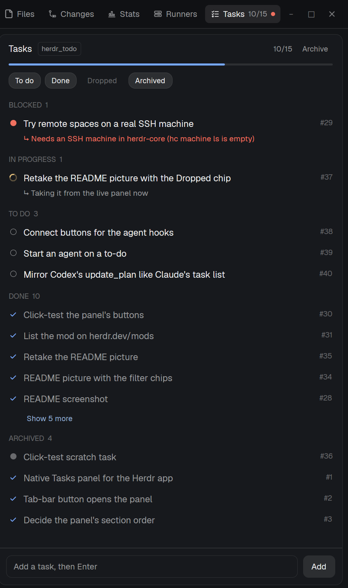

# htask

A Tasks panel for the Herdr app that shows what your coding agents have done and what's left in the
repo of the terminal you're looking at: blocked tasks first, then in progress, to do, done and
archived. Agents (Claude Code, Codex, Pi, ...) record tasks with a small `htask` CLI in one shared
SQLite database, and Claude Code's own task list is copied in by a hook. A status-bar chip shows the
count and raises a toast when a task becomes blocked; changes you make in the panel are passed back to
the agent that owns the task.

**Before adding it, know that the mod:**
- **runs programs:** `~/.local/bin/htask` (and `htask` on an SSH machine, for remote spaces), and
  `hc send` to type a message into an agent's terminal when you change its task;
- **reads files outside its folder:** the task database in `~/.local/share/herdr-tasks/` (through
  `htask`) and its `signal/` folder, which it watches;
- **needs the `htask` CLI installed first:** clone the repo and run `./install.sh` (Python 3.10+,
  standard library only). Without it the chip shows a red `htask ✗`.
- reaches no network.
- On Windows the htask CLI doesn't run: the mod uses htask on the machines the app connects to over
  SSH, and for the PC's own spaces shows a plain "Tasks" chip (no red error).

## What you see

- **Panel** (a block, usually a child of the right-hand panel stack next to Files and Changes):
  - Header, 42px: **Tasks**, the repo name in a small bordered tag, `done/total` in `muted` at 11px,
    and an **Archive** text button when there are done tasks. Opened as a window, a `×` at the right.
  - A 3px progress bar, `border` track with a `done`-colored fill, 14px side margins.
  - A scope switch before the chips: the repo's name | **All**, the chosen one on `raised`. All
    lists every repo's tasks (`htask list --everywhere`), each row tagged with its repo (`accent` for
    the focused one), the focused repo first; commands, Run and Explain use the task's own repo;
    the header says "All repos" and Archive is hidden.
  - Filter chips, 11px, fully rounded: **To do**, **Done**, **Dropped**, **Archived** (the last two
    off by default). On: `raised` background,
    `foreground` text, `border` outline. Off: transparent, `dim` text.
  - Sections in this order, each with an uppercase 10.5px `dim` heading and count: **BLOCKED**,
    **IN PROGRESS**, **TO DO**, **DONE** (the five most recent, then an `accent` **Show N more**
    link that expands it and becomes **Show fewer**), **DROPPED** (newest first, muted) and
    **ARCHIVED** (newest first), each only with its chip on. Blocked and In progress always show.
  - Each task row: a 14px status mark (to do: hollow ring in `muted`; in progress: the workspace
    spinner in `working`, spinning; blocked: filled dot in `blocked`; done: a check in `done`),
    the title (truncated until opened), `#id` in `dim` on the right. A note shows under the title as
    `↳ note`, red for blocked tasks. In-progress and blocked tasks made in another terminal show that
    agent's live state (`t6 working`, `t2 idle`, red `agent exited` / `terminal closed`). The accent
    `this terminal` tag appears only when the repo's open tasks come from more than one terminal.
  - An add box at the bottom: a bordered input ("Add a task, then Enter") and an **Add** button.
- **Chip** (a status-bar block, `props.view = "chip"`): the htask icon, `done/total` for the focused
  repo, and `● N blocked` in `blocked` when any repo has blocked tasks. `htask ✗` in red when htask
  can't run.

## How it behaves

- The panel follows focus: it shows the repo (git root) of the focused terminal. Focusing a mod pane
  (this panel, Files) keeps the last repo. It redraws when `htask` writes (it watches
  `~/.local/share/herdr-tasks/signal/`), with a 15 s backstop; remote spaces poll every 5 s.
- Click a task to open it: description, agent, terminal, "updated 5m ago", and buttons by status:
  to do: ▸ Run…, Mark in progress, Block, Done, Drop; in progress: Done, Block, Back to to-do, Drop;
  blocked: Unblock, Done, Drop;
  done and dropped: Reopen, Archive. Click the status mark to mark done (or reopen a done task).
  Click a live agent tag to focus that agent.
- **▸ Run…** on a to-do opens a menu under it, "Run this task in:", with one button per agent that
  `knownAgents({ on })` reports installed ("New Claude Code tab", last pick first) and one per live
  agent whose pane is in this repo ("Send to t6 (Pi, idle)", disabled while blocked). New tab:
  `tab.new {name: title, folder: repo, argv: agent.run, task: message}`. Send: `hc send`. The
  message names the task and asks the agent to run `htask start <id>` (which claims the task for
  the agent's terminal), `htask done`, or `htask block`. Nothing is sent to an agent not chosen.
- **Timeline** in the header swaps the task list for the activity feed (`htask timeline --json`,
  80 newest, `--everywhere` in All): day headings (TODAY, YESTERDAY, then dates), each entry "HH:MM
  who (terminal) verb #id title" (you in `accent`, finished in `done`, blocked in `blocked`), its
  detail under it; the status chips step aside. Clicking an entry returns to the list with that
  task open.
- **Agents** in the header opens a "CONNECT AGENTS" box under the chips: one row per agent (Claude
  Code, Codex, Pi; Claude and Codex get hooks, Pi only instructions) with its state (`connected` in `done`, `partly connected` in `blocked`, `not
  connected` / `not installed` in `dim`) and a Connect / Finish / Disconnect button that runs
  `htask connect <agent> [--remove]` where the space runs; a toast reports what changed, with the
  backup names. The empty state offers "New here? Connect your agents…". Its last row reads
  "htask <version> on <machine or this computer>" with **Check for updates** (`htask update --check`
  where the space runs), which becomes **Update** (`htask update`, two-minute timeout) when there are
  new commits; the result is a toast, then the version is asked again. Not on Windows' own spaces.
- When the panel's version (MOD_VERSION) and that machine's `htask --version` differ, a banner says
  so; with **Update htask there** when htask is older, **Update the panel** when htask on this
  computer is newer (its install.sh re-copies the mod), and only text for a Windows panel.
- **? Explain…** (to do, in progress, blocked) opens the same kind of menu, "Talk it through in:",
  with the task's own agent first. The message asks the agent to explain the task in its own
  conversation, as deep as needed, without starting it, to expect follow-ups, and at the end to save a
  short summary with `htask edit <id> -d`. Asking a running agent also focuses it (`agent.focus`).
- The task number is a badge at the right: 18px high, `raised`, 5px radius, the terminal font at 10px
  in `muted`.
- Links to other tasks sit under the title as chips (20px, 6px radius, 1px outline; clicking one opens
  that task, its title is the tooltip): "↳ from #31 <title>" (`border` outline); "waits for #3
  <title>" while #3 isn't done (`blocked` text, outline and a faint `blocked` fill); one "↳ from ·
  waits for #3 …" chip when both point at the same task; "N follow-ups ›" on the original (opens it),
  which, opened, lists each follow-up as a chip. Run and Explain messages mention where a task came from.
- For a to-do or in-progress task with unfinished dependencies, its Run
  menu starts with a red "Comes after #3, not done yet." line, its Done button reads **Done anyway**
  (`htask done <id> --force`), and clicking its status mark does nothing (the tooltip says why).
- Opened outside the layout (as a pane or window), the panel shows a banner: "Only in this tab…"
  with **Add to my layout**. That adds the panel to the stack holding Files/Changes and the chip
  beside the status bar (wrapping a lone status block in a row), via `layout-edit.js`'s pure
  `addToLayout`; on a shipped layout it runs `layout.clone {as: <name>-tasks}` first and applies
  `layout.set` only once `shared("layout")` shows the copy; then it shows the panel and closes the
  Tasks panes. Also `htask.dock` as a key command.
- Every change you make runs `htask --by you ...`. If the task belongs to a live agent: Claude Code
  hears about it from its inbox hook at its next step (a toast says so); any other agent gets a
  `[Herdr task panel] ...` message typed into its terminal with `hc send`, which refuses while the
  agent waits on a question (a toast then offers to take you there).
- Chips toggle sections and are remembered per panel, as is Done's expanded state. Keys can send
  `htask.toggle-todo`, `htask.toggle-done`, `htask.toggle-dropped`, `htask.toggle-archived`.
- The chip toggles the panel: it finds the panel block anywhere in the layout, selects it in its stack
  and shows hidden ancestors, or hides the outermost container that holds only the panel. With no
  panel block in the layout, it opens the panel as a floating window (`key: "htask"`).
- The chip raises a `warning` toast for each newly blocked task in any repo ("Blocked: <title>",
  body `repo #id · note`); clicking it focuses the agent's terminal. Announced ids are kept in
  `shared("htask.notified")` (per machine for remote spaces) so a restart doesn't repeat them.
- The chip publishes `shared("htask.summary")` = `{project, done, total, blocked}` for a tab-bar
  button badge.

## Built from

- `mods/htask/main.js`: the default export picks a view from `props().view`: the panel (`Panel`) or
  the chip (`chip.js`). `sections()` holds the ordering policy.
- `mods/htask/common.js`: running htask here or on a machine (`exec`, with `on`), the focused
  location (`focused()`, `panes()`, `spaces()`), finding and toggling the panel in `layout()`, and
  watching the signal folder (`watchFolder`).
- `mods/htask/chip.js`: status-bar view, `notify()`, `shared()` / `setShared()`.
- Herdr functions: `focused`, `panes`, `spaces`, `agents`, `terminals`, `layout`, `theme`, `run`
  (`layout.select`, `layout.show`, `layout.hide`, `agent.focus`), `exec`, `hc`, `watchFolder`,
  `notify`, `openOverlay`, `closeOverlay`, `shared`, `setShared`, `nextCommand`, `home`.
- Data: `htask --project <dir> list --all --json`, `list --archived --json`, and `summary` (JSON).
- Art: `htask.svg` (checklist icon, tinted), `check.svg` (done mark), and the shipped
  `mods/workspace-chrome/spinner.svg`.
- Layout blocks: `{ "id": "htask", "type": "block", "content": { "mod": "htask" } }` for the panel,
  `{ "id": "status-htask", "type": "block", "content": { "mod": "htask", "props": { "view": "chip" } }, "size": { "weight": 1.3 }, "min": 96 }`
  for the chip.

## Watch out

- A mod copy starts only once it's shown, so blocked-task toasts and the badge come from the chip:
  keep the chip in the layout. A panel that was never opened does nothing.
- Never watch the database folder: SQLite creates and deletes `-wal`/`-shm` files on every
  connection, the panel's own reads included, so a watch there reloads forever. `htask` rewrites
  `signal/changed` after each write for this reason.
- A task's terminal is the `HC_TERMINAL_ID` (or the TUI's `HERDR_PANE_ID`) of the process that ran
  htask. Sub-agents inside an agent's process (Claude Code's, Pi's) share it; only terminals started
  with `hc run` get their own. After a herdr-core restart, addresses are reused for new shells.
- Remote spaces need `htask` on that machine (`~/.local/bin/htask` or on its PATH); each machine has
  its own database. Untested against a real SSH machine.
- The panel is a copy of the repo's `mods/htask`: rerun `./install.sh` after `git pull`.

## Done when

- `herdr-app check ~/.config/herdr-app/mods/htask` passes and `herdr-app status` shows no errors.
- `htask add "try it"` in a repo makes the task appear in the panel within a second, without
  reopening it, while a terminal in that repo is focused; focusing a terminal in another repo
  switches the list.
- `htask block <id> -m "why"` raises a toast, the chip shows `● 1 blocked`, and Blocked is the first
  section.
- Clicking a task's status mark marks it done; **Archive** moves done tasks out, and the
  **Archived** chip shows them again.
- `htask doctor` prints `all good`.
